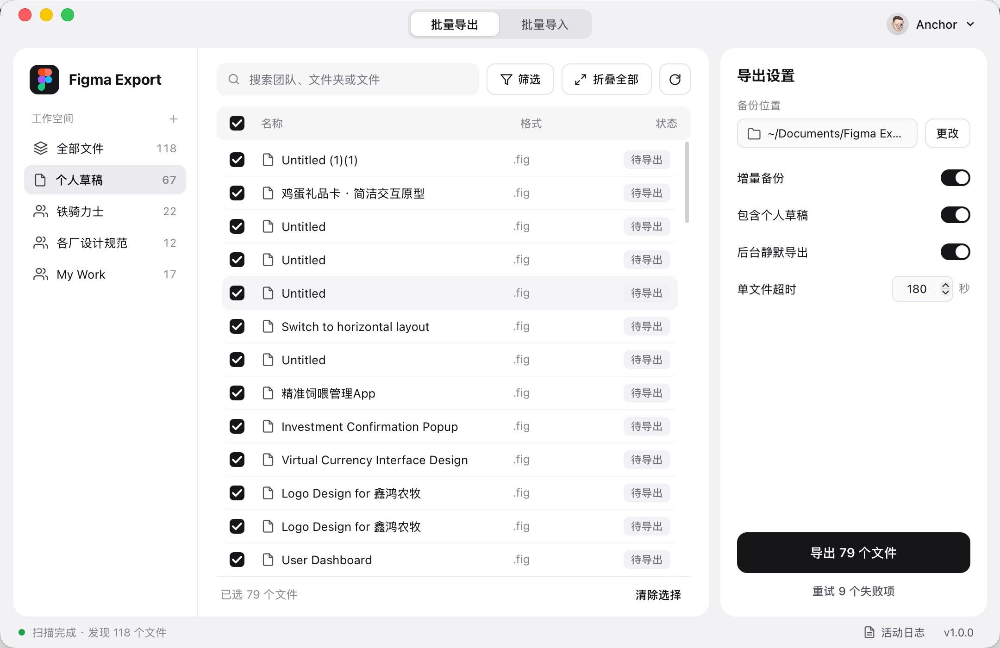
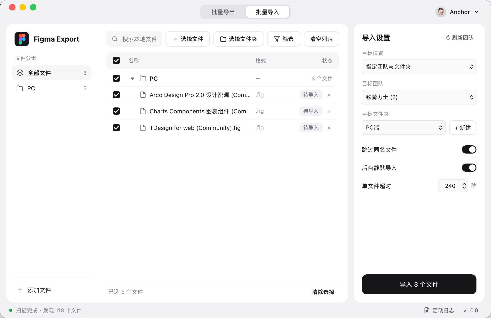

# Figma Export

轻量级跨平台 Figma 设计文件批量导出备份与导入还原桌面工具，支持 **macOS** 与 **Windows**。

从 [GitHub Releases](https://github.com/wondabao/figma-export/releases/latest) 下载对应系统的安装包（发布页同步提供 `SHA256SUMS.txt` 校验文件）：

| 系统 | 文件名后缀 |
| --- | --- |
| macOS（Apple Silicon） | `-mac-arm64.dmg` |
| macOS（Intel） | `-mac-x64.dmg` |
| Windows（x64 安装版） | `-win-x64-setup.exe` |

基于 **Tauri 2.0 + Rust + 系统原生 WebView** 构建，安装包体积仅约 **2.6 MB**，**无需安装 Google Chrome、无需安装 Node.js、无需任何外部浏览器**，开箱即用：

- **📤 批量导出备份**：自动扫描当前 Figma 账号下**所有团队、文件夹（Projects）及个人草稿箱（Drafts）**，后台静默批量导出 `.fig` / `.jam` / `.deck` 源文件，并按 `团队名 / 文件夹名 / 文件名` 自动归档。
- **📥 批量导入还原**：支持多选本地 `.fig` / `.jam` / `.deck` / `.sketch` 文件、递归扫描整个备份目录、或直接拖拽文件/文件夹至窗口，一键批量还原到**个人草稿箱**、**指定团队文件夹**，或**按本地目录结构自动匹配/新建同名文件夹还原**。

## 应用截图

### 批量导出



### 批量导入



## 核心特性

- **原生轻量，零外部依赖**：采用 Tauri 2.0 与系统原生 WebView，体积小巧、启动迅速，后台静默执行不干扰日常浏览器。
- **应用内安全登录**：在内置会话窗口中完成 Figma 登录（支持 Google SSO / 2FA / SAML），自动持久化保存登录状态，支持随时切换账号。
- **全空间自动发现**：自动拉取账号下可见的全部团队、企业组织团队、项目文件夹与个人草稿；同时支持按需手动补充未加入的公开或外部团队链接。
- **断点续传与增量备份**：通过导出目录下的 `export-manifest.json` 记录备份状态与远端更新时间，再次备份自动跳过未变更文件，同目录重名文件自动追加短标识防覆盖，并支持一键重试失败项。
- **应用内在线更新**：内置版本检测与在线更新模块，发现新版本后可在关于窗口一键下载、自动完成 SHA-256 完整性校验，重启即可完成版本替换。

## 开发运行

环境要求：**Node.js 22+** 与 **Rust stable 工具链**。

```bash
npm --prefix prototype/tauri ci
npm start
```

## 打包构建（macOS & Windows）

### 构建 macOS 安装包（`.dmg`）

```bash
npm run build:mac
```

构建产物输出至 `dist/figma-export-<version>-mac-<arch>.dmg`（也可传入 `-- --target aarch64-apple-darwin` 或 `-- --target x86_64-apple-darwin` 指定目标架构交叉编译）。

### 构建 Windows 安装包（`.exe`）

在 Windows 环境下执行：

```bash
npm run build:win
```

构建产物输出至 `dist/figma-export-<version>-win-x64-setup.exe`。

### GitHub Actions 自动发版

在 **Actions → Build macOS & Windows Installers** 可手动触发测试构建；当推送与 `package.json` 及 `tauri.conf.json` 版本一致的标签（如 `v1.0.0`）时，工作流会自动构建双平台安装包、执行映像与静默安装自检，并将安装包与 `SHA256SUMS.txt` 发布至 GitHub Releases。

## 首次打开说明

macOS 公开构建采用临时签名（ad hoc），尚未经过 Apple 公证；Windows 安装包未附加商业代码签名证书：

- **macOS**：如提示无法验证开发者，可前往 **系统设置 → 隐私与安全性**，点击 **仍要打开**。
- **Windows**：如出现 SmartScreen 提示，可点击 **更多信息 → 仍要运行**。

## 许可证

本项目基于 [MIT 许可证](LICENSE) 开源，由社区独立维护，与 Figma 官方无关联。
