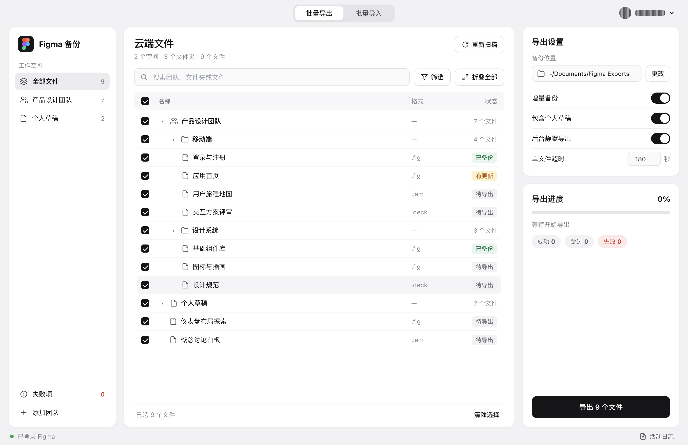
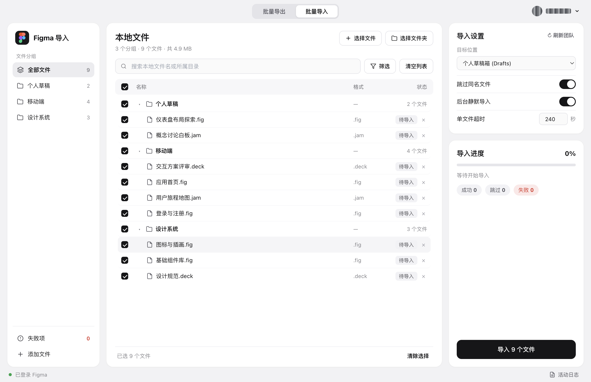

# figma-export

Figma 文件批量导入导出工具，支持 macOS 和 Windows。

从 [GitHub Releases](https://github.com/wondabao/figma-export/releases/latest) 下载对应的安装包。发布页也提供 `SHA256SUMS.txt` 供校验。

| 系统 | 文件名后缀 |
| --- | --- |
| macOS，Apple Silicon | `-mac-arm64.dmg` |
| macOS，Intel | `-mac-x64.dmg` |
| Windows，x64 安装版 | `-win-x64-setup.exe` |
| Windows，x64 便携版 | `-win-x64-portable.exe` |

基于 **Electron** 构建的跨平台独立桌面软件，**无需安装 Google Chrome、无需安装 Node.js、无需任何外部浏览器**，双击打开即可完成：
- **📤 批量导出备份**：自动扫描当前 Figma 账号下**所有团队、所有文件夹及个人草稿箱 (Drafts)**，后台静默批量导出 `.fig` / `.jam` / `.deck` 源文件，并按 `团队名 / 文件夹名 / 文件名` 自动归档。
- **📥 批量导入还原**：支持多选本地 `.fig` / `.jam` / `.deck` / `.sketch` 文件、选择整个文件夹递归扫描、或直接拖拽文件/目录到窗口，一键批量导入到**个人草稿箱 (Drafts)**、**指定团队文件夹**，或**按本地目录结构在指定团队下自动匹配/新建同名文件夹还原**。

## 应用截图

以下截图展示 macOS 应用中的示例团队、项目和文件。账号名称与头像已打码。

### 批量导出



### 批量导入



## 核心特性

- **开箱即用，零浏览器依赖**：内置完整运行引擎，macOS（`.dmg`）与 Windows（`.exe`）双击即用，不弹窗干扰日常浏览器。
- **软件内安全登录**：在应用内嵌窗口中登录 Figma（支持 Google SSO / 2FA / SAML），自动持久化登录状态。
- **全量自动发现**：自动拉取账号下所有可见团队、组织团队、文件夹（Projects）与个人草稿箱（支持手动补充团队链接）。
- **后台静默导出 `.fig` 源文件**：原生拦截下载流直接归档至 `导出目录/团队名/文件夹名/文件名.fig`，同文件夹重名自动追加短 Key 避免覆盖。
- **断点续传与增量备份**：通过 `export-manifest.json` 记录导出状态与远端更新时间，再次运行自动跳过未更新文件，支持一键重试失败项。

## 开发运行

使用 Node.js 22 和 npm 安装锁定的依赖。

```bash
npm ci
npm start
```

## 打包安装包（macOS & Windows）

### 打包 macOS 安装包（`.dmg`）
```bash
npm run build:mac
```
产物位于 `dist/` 目录（同时生成 Apple Silicon `arm64` 与 Intel `x64` `.dmg` 安装包）。

### 打包 Windows 安装包（`.exe`）
在 Windows 电脑上执行：
```bash
npm run build:win
```
产物位于 `dist/` 目录（生成 NSIS 安装程序 `.exe` 及免安装便携版 `.exe`）。

### GitHub Actions

在 **Actions → Build macOS & Windows Installers** 手动运行工作流，可从该次运行下载测试构建。推送与 `package.json` 版本相同的标签（例如 `v1.0.0`）后，构建和 Windows 安装检查全部通过时，工作流会将安装包和 SHA-256 校验文件发布到 GitHub Releases。

## 首次打开

macOS 公开构建采用临时签名（ad hoc），尚未通过 Apple 公证。Windows 安装包没有发布者签名。

- macOS 如提示无法验证开发者，可前往 **系统设置 → 隐私与安全性**，选择 **仍要打开**。
- Windows 如出现 SmartScreen 提示，可选择 **更多信息 → 仍要运行**。

## 许可证

本项目采用 [MIT 许可证](LICENSE)，由社区独立维护，与 Figma 官方无关联。
